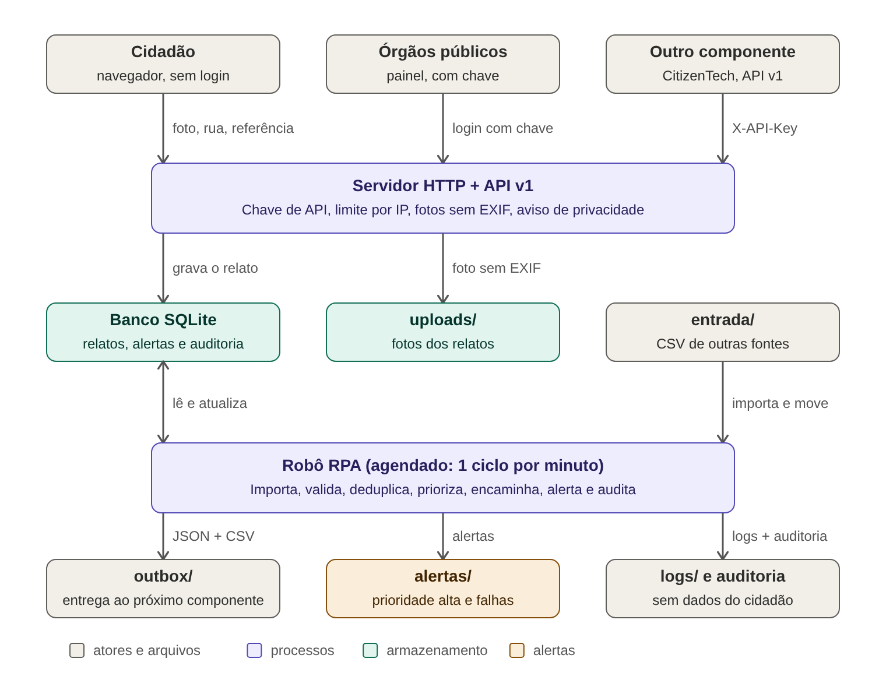
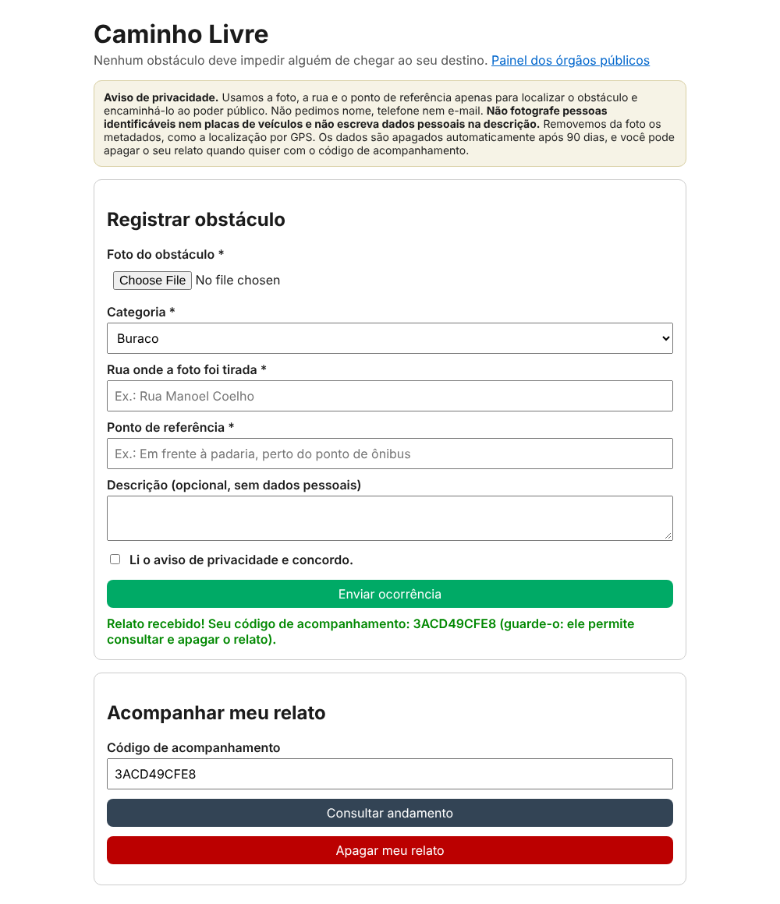
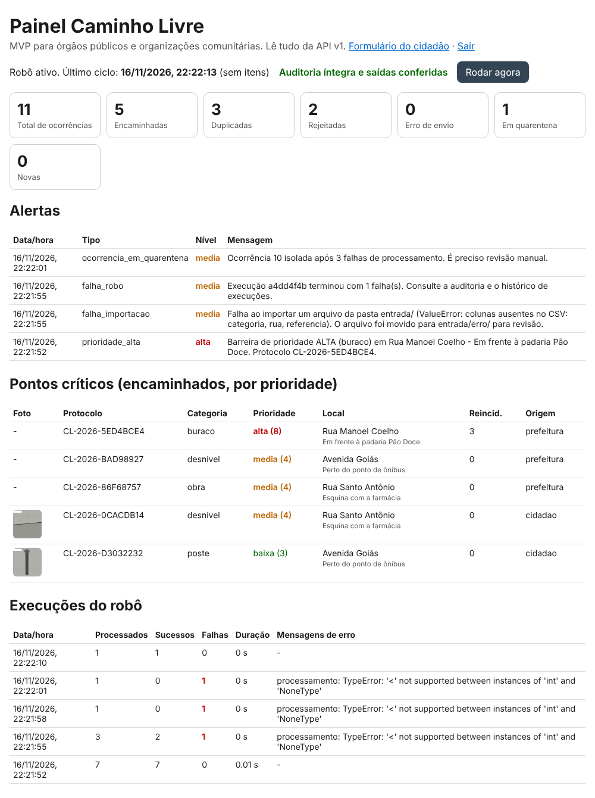

# Caminho Livre — Tecnologia para uma cidade acessível

> **Nenhum obstáculo deve impedir alguém de chegar ao seu destino.**

Projeto da **CitizenTech** em **São Paulo**. Uma plataforma que registra obstáculos nas
calçadas e ajuda pessoas com deficiência, idosos e pessoas com mobilidade reduzida a encontrar
caminhos mais seguros. Este repositório entrega a **automação de bastidores** (RPA em Python) que
transforma relatos soltos em dados organizados e prontos para o MVP.

> **Hipótese inicial.** O problema (calçadas com buracos, desníveis, postes, lixeiras, veículos e obras) é
> uma hipótese a ser validada com visitas ao território, registros fotográficos e conversas com os
> cidadãos afetados. Ela não deve ser apresentada como diagnóstico comprovado.

**FIAP · Engenharia de Software · Global Solution 2026.2 · Robotic Process Automation**

## Integrantes

| Nome | RM | 
|---|---|---|
| Arthur Abreu | 98283 | 
| Arthur Petrin| 98735| 
| Giuliano Marques | 99694|

## Etapas obrigatórias do RPA: onde encontrar cada uma

| # | Etapa | Onde está neste repositório |
|---|---|---|
| 01 | Mapeamento do processo | [`docs/PDD.md`](docs/PDD.md), [fluxo geral](docs/fluxograma_geral.png) e [fluxo por ocorrência](docs/fluxograma_por_ocorrencia.png): início, entradas, etapas, decisões, repetições, exceções e saídas |
| 02 | Desenvolvimento da automação | Python em [`src/`](src/): robô em `rpa_caminho_livre.py` e servidor/API em `servidor_caminho_livre.py`. O Power Automate não foi usado ([motivo](power-automate/README.md)) |
| 03 | Lógica de negócio e lote | Decisões em `validar()`, `achar_duplicata()` e `calcular_prioridade()`; repetição sobre a fila de ocorrências e sobre o lote ordenado por prioridade em `executar()` |
| 04 | Exceções e resiliência | Retry do encaminhamento, quarentena após 3 falhas, CSV inválido movido para `entrada/erro/` com alerta, duplicidades entre fontes, trava de execução única ([PDD, seção 6](docs/PDD.md#6-exceções-e-resiliência)) |
| 05 | Logs e auditoria | `rpa.log`, histórico de execuções e auditoria encadeada por hash, sem dados sensíveis ([amostras em `logs/`](logs/)) |
| 06 | Integração com o MVP | API `GET /api/v1/encaminhamentos`, banco SQLite e arquivos JSON/CSV em `outbox/`; consumo demonstrado por [`src/consumidor_exemplo.py`](src/consumidor_exemplo.py) |
| 07 | Testes e validação | [`tests/`](tests/): 30 testes unitários e 48 verificações ponta a ponta com cenários de sucesso, decisão e falha ([evidências](tests/evidencias/)) |
| 08 | Documentação e publicação | Este README, [`docs/`](docs/), [`assets/`](assets/) e o repositório público no GitHub |

## O problema e quem se beneficia

Pessoas que usam cadeira de rodas, com deficiência visual, idosos, pessoas com mobilidade reduzida e quem
usa carrinho de bebê muitas vezes não sabem se o caminho até o destino é acessível antes de sair de casa.
Do outro lado, relatos chegam por várias origens (cidadão, prefeitura, ONGs) e alguém teria de **conferir,
juntar, priorizar e repassar tudo à mão**. Essa é a oportunidade de automação deste repositório.

## O que a automação faz

O robô roda **sozinho a cada 1 minuto** e executa, sem intervenção humana:

1. **Conecta fontes:** relatos do cidadão (foto + rua + ponto de referência) e arquivos CSV de outras origens (pasta `src/entrada/`).
2. **Valida** cada ocorrência (campos, foto, categoria) e **rejeita** as inválidas com motivo.
3. **Detecta duplicidades**, mesmo entre fontes diferentes (mesma foto, ou mesma rua + referência parecida).
4. **Prioriza** (categoria + reincidências), gera **protocolo** `CL-ANO-CÓDIGO` e **encaminha** o lote.
5. **Alerta** quando a prioridade chega a *alta*, quando um arquivo não pode ser importado, quando um item vai para quarentena e quando uma execução falha.
6. **Entrega ao MVP** por API, banco de dados e arquivos estruturados (JSON/CSV), e mostra tudo no painel dos órgãos públicos.
7. **Registra** logs sem dados sensíveis, histórico de execuções e uma **trilha de auditoria encadeada** que detecta adulteração.



Fluxogramas e o documento de definição do processo (PDD) estão em [`docs/`](docs/):
[PDD](docs/PDD.md) · [fluxo geral](docs/fluxograma_geral.png) · [fluxo por ocorrência](docs/fluxograma_por_ocorrencia.png).

## Como rodar

**Requisito:** Python 3.9 ou superior (testado com 3.12). Não precisa instalar nenhuma biblioteca.
Não esqueça de entrar na pasta src
```bash
cd src
python servidor_caminho_livre.py        # Windows: py servidor_caminho_livre.py (ou iniciar.bat)
```
## url http://127.0.0.1:8000

Ao ligar, o servidor já inicia o **robô agendado de 1 em 1 minuto**.

| O quê | Onde |
|---|---|
| Formulário do cidadão (aviso de privacidade, foto, rua, referência) | http://localhost:8000 |
| Painel dos órgãos públicos (pede a chave que fica em `src/chave_api.txt`) | http://localhost:8000/painel |
| API para outros componentes (cabeçalho `X-API-Key`) | http://localhost:8000/api/v1/encaminhamentos |

1. Abra o formulário, envie um relato e guarde o **código de acompanhamento**.
2. A pasta `src/entrada/` já traz `prefeitura_exemplo.csv` (dados fictícios): em até 1 minuto ele é importado e processado.
3. Consulte o andamento pelo código, abra o painel e veja a pasta `src/alertas/`.
4. Em outro terminal: `python consumidor_exemplo.py` simula outro componente consumindo a API.
5. Para conferir a integridade: `python rpa_caminho_livre.py --verificar`.

Outros comandos do robô (`python rpa_caminho_livre.py ...`): `--agendar [MIN]`, `--importar arq.csv --origem ong`,
`--limpar [DIAS]`, `--apagar CODIGO`, `--reprocessar ID`, `--verificar`, `--seed`. Também é possível agendar pelo
sistema operacional (cron ou Agendador de Tarefas); como há trava de execução única, não há duplicidade.

## Estrutura do repositório

```
caminho-livre/
├── README.md            descrição, integrantes, arquitetura, instruções e links
├── src/                 código-fonte Python (robô, servidor, consumidor de exemplo, CSV de exemplo)
├── power-automate/      não utilizado (a automação foi feita em Python); traz o mapeamento equivalente
├── docs/                PDD e fluxogramas (SVG e PNG)
├── assets/              capturas de tela reais da aplicação funcionando
├── logs/                amostras de logs e auditoria, sem dados sensíveis
└── tests/               testes automatizados e as evidências da execução
```

## Segurança e LGPD

- **Minimização:** não pedimos nome, telefone nem e-mail; a localização é só rua + ponto de referência (sem GPS).
- **Fotos sem metadados:** EXIF/GPS são removidos antes de guardar; o aviso orienta a não fotografar pessoas e placas.
- **Consentimento e transparência:** aviso de privacidade com aceite obrigatório no formulário.
- **Direitos do titular:** o código de acompanhamento permite consultar e **apagar** o próprio relato.
- **Retenção:** dados, fotos e arquivos de saída são apagados após 90 dias (automático, uma vez por dia).
- **Acesso:** API e painel exigem chave; o servidor escuta só em `127.0.0.1` por padrão; HTTPS opcional (`--cert`, `--key`).
- **Proteção da aplicação:** limite de requisições por IP, validação do conteúdo real da imagem, SQL parametrizado, cabeçalhos CSP/nosniff.
- **Logs sem dados pessoais:** só ids e protocolos; filtro remove e-mail, CPF, telefone, coordenadas e caminhos.

> **Antes de publicar:** o `.gitignore` já exclui `chave_api.txt`, o banco, as fotos e os arquivos gerados.
> Nunca envie esses itens a um repositório público.
> Pendências para a equipe (não é aconselhamento jurídico): definir base legal, controlador e encarregado (DPO)
> e redigir a política de privacidade completa.

## Testes e evidências

```bash
python tests/test_unitarios.py       # 30 testes unitários
python tests/test_integracao.py      # 48 verificações ponta a ponta, com o servidor ligado
```

Resultados reais em [`tests/evidencias/`](tests/evidencias/), capturas de tela em [`assets/`](assets/) e amostras
de logs em [`logs/`](logs/).

> **Sobre o `TypeError` nas evidências:** o erro que aparece nas amostras de log e no painel foi **provocado de
> propósito** pelo teste de integração. Ele insere um registro corrompido (`reincidencias = NULL`) para provar que
> o robô registra a falha, tenta de novo e, na 3ª falha, isola a ocorrência em quarentena com alerta, sem travar a fila.

| Formulário do cidadão | Painel dos órgãos públicos |
|---|---|
|  |  |

## Limitações

- A **categoria** do obstáculo ainda é escolhida pelo cidadão; a **visão computacional** (análise da foto) e o **mapa de acessibilidade com cálculo de rotas** pertencem a outras etapas do projeto e não estão neste repositório.
- Os alertas saem em arquivo, API e painel (sem e-mail ou mensagem).
- A chave de API é única e compartilhada; para produção, usar contas por usuário e HTTPS por um proxy.
- O banco é SQLite, adequado ao MVP; para produção, trocar por um banco compartilhado.
- Dados e relatos nos exemplos e nos testes são **fictícios**.

## Links

- Repositório: https://github.com/USUARIO_PREENCHER/caminho-livre
- Vídeo de demonstração: LINK_DO_VIDEO_PREENCHER
- Apresentação: LINK_DA_APRESENTACAO_PREENCHER
