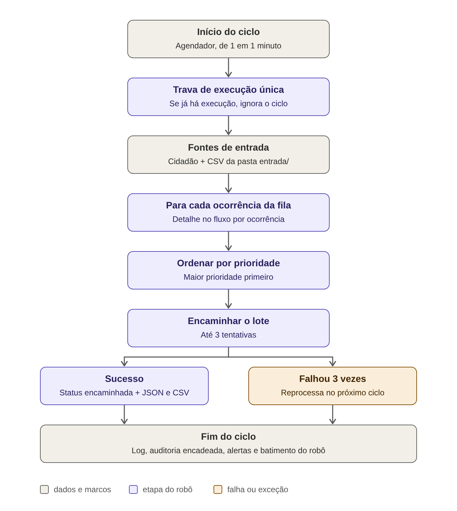
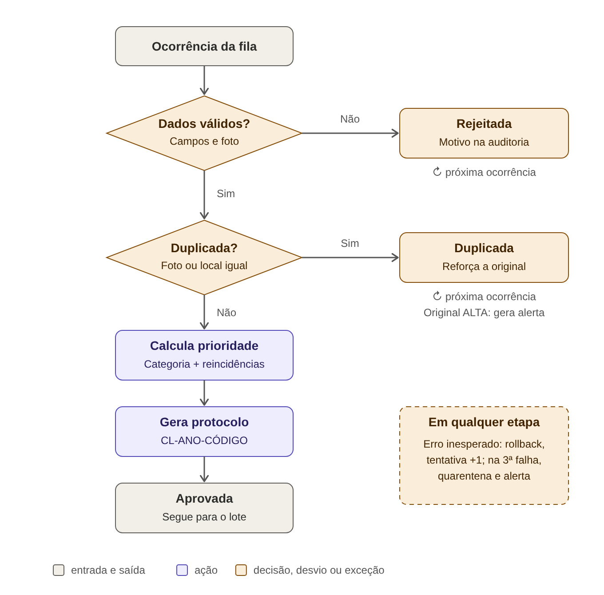

# PDD — Documento de Definição do Processo

**Processo:** triagem e encaminhamento de ocorrências de acessibilidade nas calçadas
**Projeto:** Caminho Livre (CitizenTech) · **Território:** São Caetano do Sul (SP), região-piloto a definir após observação de campo
**Tipo de automação:** RPA em Python (biblioteca padrão), sem interface de terceiros
**Estado:** MVP funcional. A hipótese do problema ainda precisa ser validada em campo.

## 1. Objetivo e escopo

Automatizar os bastidores do Caminho Livre: reunir relatos de várias origens, validar, eliminar duplicidades,
priorizar, gerar protocolo, encaminhar, alertar e deixar tudo auditável, **entregando dados organizados ao MVP**
com a mínima intervenção humana.

| Dentro do escopo | Fora do escopo (outras etapas do projeto) |
|---|---|
| Receber relatos do cidadão e de CSV externos | Visão computacional para identificar obstáculos na foto |
| Validação, duplicidade, prioridade, protocolo | Mapa de acessibilidade e cálculo de rotas |
| Encaminhamento por API, banco e arquivos | Aplicativo móvel nativo |
| Alertas, logs, auditoria, LGPD básica | Integração com sistemas reais da prefeitura |

## 2. Processo atual (manual), sem a automação

1. Uma pessoa recebe relatos por canais diferentes (formulário, planilhas da prefeitura e de ONGs).
2. Abre cada relato e confere se está completo.
3. Procura, na memória ou numa planilha, se o mesmo problema já foi relatado.
4. Decide o que é mais urgente.
5. Cria um número de protocolo e repassa à equipe responsável.
6. Avisa alguém quando algo é grave.
7. Anota o que fez, quando e por quê.
8. Repete isso todos os dias, e qualquer atraso ou erro passa despercebido.

## 3. Processo automatizado (to-be)

| Passo manual | Como o robô resolve |
|---|---|
| 1. Juntar relatos | Importa os CSV da pasta `entrada/` e recebe o formulário do cidadão, marcando a **origem** |
| 2. Conferir | Valida campos, foto e categoria; rejeita com motivo registrado |
| 3. Achar duplicidade | Mesma foto, ou mesma rua + referência parecida, na janela de 30 dias, **entre fontes** |
| 4. Priorizar | Pontos da categoria + reincidências (baixa, média, alta) |
| 5. Protocolo e repasse | Protocolo `CL-ANO-CÓDIGO`; JSON por execução, CSV e API v1 |
| 6. Avisar | Alertas em arquivo, API e painel |
| 7. Registrar | Log, histórico de execuções e auditoria encadeada |
| 8. Repetir todo dia | Agendamento de 1 em 1 minuto, com trava de execução única |

## 4. Entradas e saídas

| Entradas | Formato | Origem |
|---|---|---|
| Relato do cidadão | Foto (JPG/PNG/WEBP, até 8 MB), categoria, rua, ponto de referência, descrição opcional, aceite do aviso | Formulário / `POST /api/ocorrencias` |
| Relatos de outras fontes | CSV com `categoria, rua, referencia` e opcionais `descricao, id_externo` | Pasta `src/entrada/` (origem = texto antes do 1º `_` do nome) |

| Saídas | Onde | Consumidor |
|---|---|---|
| Ocorrências com status, protocolo e prioridade | Banco SQLite e `GET /api/v1/encaminhamentos` (consumo incremental com `desde_id`) | MVP e outros componentes |
| Lote entregue | `outbox/encaminhamentos_*.json` (atômico) e CSV diário | Equipe responsável |
| Alertas | `alertas/alertas.jsonl`, `GET /api/v1/alertas`, painel | Órgãos públicos |
| Histórico do robô | Tabela `execucoes`, `logs/execucoes.jsonl`, `GET /api/v1/execucoes` | Operação |
| Auditoria | Tabela `auditoria` (encadeada), `GET /api/v1/auditoria`, `--verificar` | Auditoria |

## 5. Regras de negócio

- **Campos obrigatórios:** categoria, rua e referência. A foto é obrigatória só para a origem `cidadao`.
- **Categorias:** buraco, desnível, obra, veículo, poste, lixeira, outro.
- **Duplicidade:** mesma categoria, últimos 30 dias, e (mesma foto **ou** rua ≥ 85% parecida e referência ≥ 60% parecida). A comparação ignora acentos, maiúsculas e abreviações (`R.` = `Rua`).
- **Prioridade:** pontos da categoria (buraco 5; desnível e obra 4; poste e veículo 3; lixeira 2; outro 1) + reincidências (no máximo 5). **Alta** a partir de 7, **média** de 4 a 6, **baixa** abaixo de 4.
- **Alertas:** prioridade alta (um por ocorrência); falha de importação; ocorrência em quarentena; falha da execução (no máximo um a cada 15 minutos).

## 6. Exceções e resiliência

| Situação | Tratamento |
|---|---|
| Erro em uma ocorrência | Rollback só dela e tentativa contada. **Na 3ª falha vai para quarentena** (`erro_permanente`), com alerta, e deixa de travar a fila. `--reprocessar ID` devolve à fila |
| Falha ao encaminhar o lote | 3 tentativas com espera crescente; depois `erro_encaminhamento` e novo envio no ciclo seguinte |
| CSV defeituoso | Movido para `entrada/erro/` e gera alerta |
| Falha ao gravar um alerta | Entra no resumo da execução como falha |
| Duas execuções simultâneas | A segunda é ignorada (trava de execução única); a trava abandonada há mais de 10 minutos é removida |
| Banco ocupado | Espera até 30 segundos |

## 7. Logs, auditoria e verificação

- **Log** (`rpa.log`, com rotação): data/hora, id da ocorrência e resultado. Sem dados do cidadão.
- **Histórico de execuções:** data/hora, duração, processados, sucessos, falhas e mensagens de erro (sanitizadas).
  *Falhas* são só erros técnicos; ocorrência rejeitada ou duplicada conta como sucesso, pois o robô a tratou corretamente.
- **Auditoria encadeada:** cada evento guarda o hash do anterior. Alterar ou apagar uma linha quebra a cadeia.
- **`--verificar`:** confere a cadeia, os arquivos de saída e (com `--url`) o que a API entrega, e termina com código 1 se houver divergência.
- **Batimento:** ciclos sem itens não poluem o log; só atualizam "robô ativo, último ciclo às ...", mostrado no painel.

## 8. Segurança e LGPD

| Medida | Como |
|---|---|
| Minimização | Sem nome, telefone ou e-mail; localização só por rua e referência (sem GPS) |
| Metadados | EXIF/GPS (JPEG), textos e data (PNG) e EXIF/XMP (WEBP) removidos. Efeito colateral: a rotação automática da foto pode se perder |
| Transparência e consentimento | Aviso de privacidade com aceite obrigatório |
| Direitos do titular | Código de acompanhamento para consultar e **apagar** o próprio relato |
| Retenção | 90 dias, com limpeza automática diária |
| Controle de acesso | Chave de API (header, Bearer ou cookie HttpOnly/SameSite); escuta só em `127.0.0.1`; HTTPS opcional |
| Proteção da aplicação | Limite por IP, validação do conteúdo da imagem, SQL parametrizado, texto escapado, CSP |
| Logs | Só ids e protocolos; filtro remove e-mail, CPF, telefone, coordenadas, hashes e caminhos |

**Pendências e riscos (não é aconselhamento jurídico):** definir base legal, controlador e encarregado (DPO) e
redigir a política de privacidade completa. Cópias já entregues em `outbox/` permanecem até a retenção. Banco e
arquivos não são criptografados em repouso. A descrição em texto livre pode conter dados pessoais digitados pelo cidadão.

## 9. Operação e agendamento

- Ao ligar o servidor, o robô já fica agendado a cada 1 minuto (`--intervalo N` muda; `--sem-agendador` desliga).
- Sem o servidor: `python rpa_caminho_livre.py --agendar`.
- Pelo sistema operacional: cron `* * * * *` ou `schtasks /sc minute /mo 1`; a trava evita duplicidade.
- Uma vez por dia o agendador aplica a retenção.

## 10. Indicadores coletados

Por execução: processados, sucessos, falhas, encaminhadas, duplicadas e rejeitadas, duração e erros. No painel:
totais por status, alertas, pontos críticos por prioridade e batimento do robô. Os indicadores de **ganho de tempo**
em relação ao processo manual ainda precisam ser medidos pela equipe em campo; este repositório não traz esse número.

## 11. Premissas, limitações e próximos passos

- A categoria é escolhida pelo cidadão; a visão computacional (etapa 2 do projeto) ainda não foi integrada.
- A chave de API é única; para produção, usar contas por usuário e HTTPS.
- SQLite adequado ao MVP; para produção, usar um banco compartilhado.
- Plugar outros canais de alerta (Teams, WhatsApp, webhook) em `criar_alerta()`.
- Validar com o território e com a prefeitura os pesos de prioridade e os limites de duplicidade.
